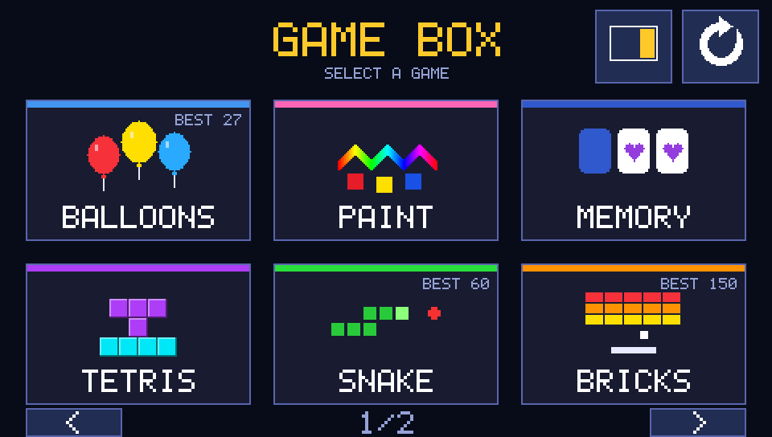

# STM32F7 Discovery GAME BOX

STM32F746G-DISCO kartının 4.3" dokunmatik ekranı için oyun koleksiyonu.
Ana menüden oyun seçilir, her oyundan **EXIT** ile menüye dönülür.

*Ana menü: karttaki framebuffer'dan (SDRAM) alınmış ekran görüntüsü, 2x büyütülmüş.*

| Oyun | Kontrol |
|---|---|
| **Tetris** | Dokunmatik butonlar (döndür, sola/sağa, hızlı düşür, bırak), ghost parça, başlangıç seviyesi 1–15 |
| **Snake** | Yön tuşları, seviye 1–10 |
| **Bricks** | Raketi parmakla sürükle ya da ok tuşları; rastgele bonuslar (W geniş raket, S yavaş top, F ateş topu, + can) |
| **Flappy** | Ekrana ya da FLAP tuşuna dokun, seviye 1–10 (boru hızı / boşluk) |
| **2048** | Tahtada kaydır ya da yön tuşları |
| **Mines** | Dokun: aç, basılı tut: bayrak, sayıya dokun: etrafını aç; seviye 1–5 |
| **Balloons** | Küçük çocuklar için: yükselen balonlara dokunup patlat, kaybetmek yok |
| **Paint** | Küçük çocuklar için: 12 renk (gökkuşağı kalemi dahil), 3 fırça kalınlığı; resim çıkışta saklanır |
| **Memory** | Küçük çocuklar için: renkli şekilli kartları eşleştir; 3 çiftten başlayıp 8 çifte kadar zorlaşır |

Çocuk oyunlarında EXIT ve CLEAR, kazara basılmasın diye **basılı tutularak** çalışır.

Ana menünün sağ üstünde iki ayar tuşu vardır (seçimler Flash'ta saklanır):
- **Kontrol tarafı:** Tetris, Snake, Bricks, Flappy, 2048 ve Mines'ta kontrol
  panelini sağa (varsayılan) ya da sola alır.
- **Döndür:** Ekranı 180° çevirir.

En yüksek skorlar dahili Flash'ta kalıcı olarak saklanır ve menüdeki kartlarda gösterilir.

Oyundan EXIT ile çıkıp geri dönünce oyun kaldığı yerden devam eder (kart açık
kaldığı sürece). Aksiyon oyunları duraklatılmış olarak açılır; duraklatma
kutusundaki **NEW** ile baştan başlanabilir. Dışarıda geçen süre bonus
sürelerinden ve Mines saatinden sayılmaz.

## Donanım

- **Kart:** STM32F746G-DISCO (STM32F746NG, Cortex-M7 @ 200 MHz)
- **Ekran:** 480x272 RGB565, LTDC; framebuffer harici SDRAM'de (`0xC0000000`)
- **Dokunmatik:** FT5336 (I2C3)

## Derleme

1. STM32CubeIDE 2.x ile **File → Import → Existing Projects into Workspace** ile bu klasörü aç.
2. **Build Project**, ardından **Run/Debug As → STM32 C/C++ Application**.

Proje STM32CubeMX ile üretildi (`stm32f7disco_gamebox.ioc`, FreeRTOS). Uygulama kodu
CubeMX'in `USER CODE` bloklarında ve ayrı dosyalarda olduğu için kod yeniden
üretildiğinde korunur.

## Kod yapısı

| Dosya | İçerik |
|---|---|
| `Core/Src/display.c` | MPU ayarı, SDRAM açılışı ve doğrulaması, dokunmatik sürücüsü |
| `Core/Src/gfx.c` | Framebuffer'a çizim, 5x7 font, butonlar, oklar, rastgele sayı |
| `Core/Src/menu.c` | Ana menü, oyun listesi (sayfalı) |
| `Core/Src/scores.c` | Kalıcı skorlar (Flash sektör 7'de kayıt günlüğü) |
| `Core/Src/tetris.c`, `snake.c`, `bricks.c`, `flappy.c`, `game2048.c`, `mines.c` | Oyunlar |

### Yeni oyun eklemek

1. `Core/Src/<oyun>.c` içinde `XXX_Run()` (EXIT'e basılınca geri döner) ve `XXX_DrawIcon()` yaz.
2. Prototipleri `Core/Inc/games.h`'ye ekle.
3. `Core/Inc/scores.h`'deki listenin sonuna bir `SCORE_XXX` yuvası ekle.
4. `Core/Src/menu.c`'deki `games[]` listesine bir satır ekle.

## Notlar

- **SDRAM açılışı:** SDRAM'in mode register'ı güç verildiğinde rastgele başlar ve
  yanlış modda kalırsa her yazma 4 hücreye yayılır (ekranda bozuk yazılar/çizgiler).
  Açılış dizisi bu yüzden LTDC başlamadan önce (`MX_FMC_Init` içinde) çalışır,
  her komuttan sonra FMC'nin hazır olmasını bekler ve sonunda bir bellek testiyle
  doğrulanır. Reset SDRAM'in gücünü kesmediği için bu tür değişiklikler mutlaka
  kartın gücü kesilip açılarak test edilmelidir.
- **MPU:** CubeMX'in varsayılan MPU ayarı `0x60000000–0xDFFFFFFF` aralığını kapatır;
  `Display_MPU_Config()` FMC register'larını ve SDRAM'i yeniden açar.
- **Skorlar:** Flash'ın son 256 KB'lık sektörü (`0x080C0000`) kullanılır. Program
  bu sektöre taşarsa kalıcı kayıt kendiliğinden kapanır.
